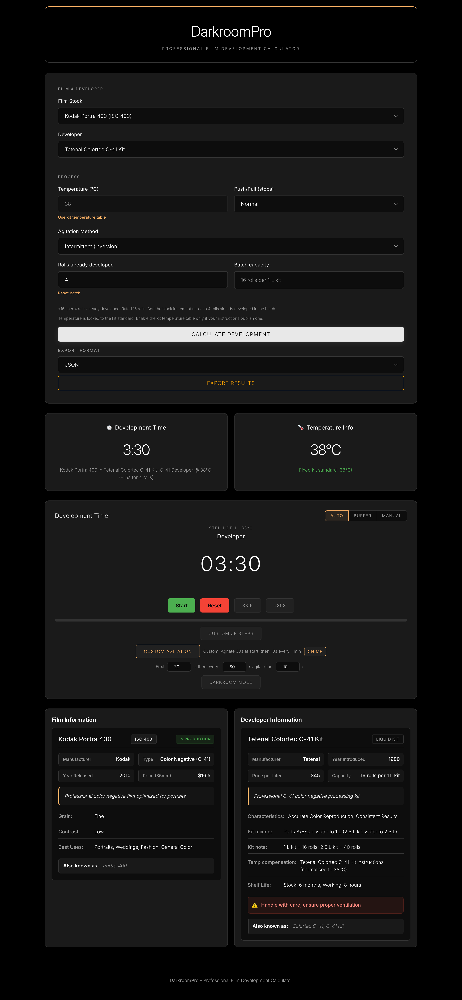
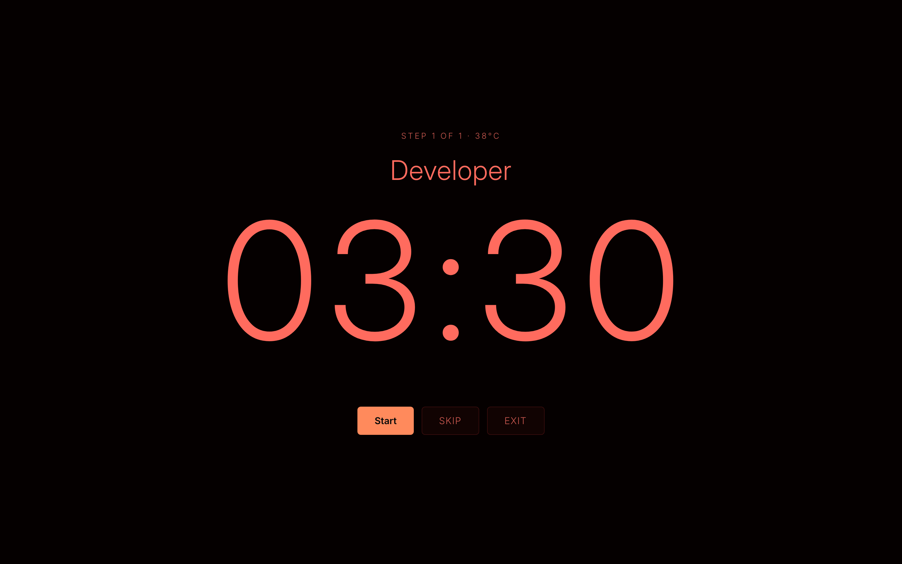

# 🧪 DarkroomPro

A professional desktop application for calculating **precise film development parameters** with scientifically accurate timing, temperature compensation, and published push/pull data for 433 film/developer combinations.


## 📸 App Preview



*Main window: film/developer selection, process controls (kit temperature lock, batch reuse, agitation method), calculation results, the timer with custom agitation, and the sourced film/developer information panels.*



*Darkroom mode's fullscreen focus display, toggled with <kbd>F</kbd> or the Auto Fullscreen option.*

## 🆕 What's new in 1.3.2

- **Dilution ratio and volume input removed**: the ratio is printed on the developer bottle and named in the developer selector, so the app no longer repeats it or asks for a tank volume. Tank volume does not change development time, so there is nothing to calculate.
- **Kit mixing and capacities**: every colour kit now shows its actual kit mixing and capacity, including Bellini C41-RA (500 ml concentrate + 500 ml water = 1 L, 16 rolls) and Kodak Flexicolor (2.5 L, 20 rolls one-shot).
- **Better agitation chimes**: ticks now repeat every ~1.1s at a clearly audible level, with a distinct two-tone stop cue when the agitation window ends. The scheduler ensures only one sequence plays at a time.
- **Timer cleanup fix**: pausing or resetting now immediately clears the pulsing orange agitation dot, the “Agitate now” text, and the completion flash instead of leaving them running.
- **Kodak E-6 +2 push corrected** to 11:30 rotary / 11:45 manual (+5:30 per Kodak Z-119).
- Includes 1.3.1’s adjustable B&W rotary compensation and E-6 method-specific timing.

See [RELEASE_NOTES.md](RELEASE_NOTES.md) for the full changelog.

## 🎯 **Key Features**

- **47 Film Stocks** - Comprehensive database of B&W, color negative, and slide films
- **18 Developers** - Popular developers with precise dilution ratios  
- **433 Combinations** - Sourced film/developer pairings with provenance
- **Temperature Compensation** - Per-developer curves sourced from manufacturer charts (15-30°C)
- **Push/Pull Processing** - +3 push and -2 pull stops where published; B&W uses the documented Massive Dev Chart guideline when a row is missing
- **Agitation Method** - Intermittent or rotary/continuous; rotary uses an adjustable 0-35% B&W developer-time reduction (15% default, starting point)
- **Multi-Step Timer** - Auto, Buffer and Manual step transitions with a customizable step editor
- **Agitation Reminders** - Published schedules or your own interval/duration, with optional repeating chimes during each agitation window
- **Batch Reuse Compensation** - Track rolls already developed through a batch; applies the kit's published compensation (CineStill, Tetenal, Bellini) where one exists
- **Darkroom Mode** - Safelight theme plus wake-lock and fullscreen options in one toggle; the fullscreen focus display opens when the timer starts (Auto Fullscreen option) or with the F key
- **Built-in Timer** - Integrated countdown with audio alerts
- **Export Functionality** - Save calculations as JSON, CSV, or PDF
- **Cross-Platform** - Native apps for macOS, Windows, and Linux

## ✨ Features

### 📊 **Comprehensive Database**
- **47 Film Stocks**: Complete database of B&W, color negative, and slide films
- **18 Developers**: Popular developers with precise dilution ratios
- **433 Combinations**: Sourced film/developer pairings with provenance
- **Manufacturer Grouping**: Films organized by brand for easy selection

### 🧮 **Advanced Calculations**
- **Temperature Compensation**: Per-developer curves for B&W developers from Kodak and Ilford charts, with a standard conversion fallback where no manufacturer chart exists. Colour kits are locked to the kit's standard temperature; kits that publish a temperature table can be unlocked explicitly
- **Agitation Method**: Intermittent (inversion) or rotary/continuous. For black & white, rotary processing uses an adjustable 0-35% reduction (15% default; 15-35% may be needed depending on film/developer, and pre-wetting or a diffusion enlarger can need less). E-6 first-developer times switch between the published manual and rotary values; C-41 uses the kit time
- **Push/Pull Processing**: +3 push and -2 pull stops. B&W falls back to the documented Massive Dev Chart guideline when no EI row exists; colour push/pull is offered only where the kit publishes a time (no estimated values)
- **Published Dilution Data**: each developer's published dilution is listed in its info panel; pick the matching one in the selector
- **Type-Safe Calculations**: Rust-powered calculation engine for guaranteed accuracy

### ⏱️ **Professional Timer**
- **Multi-Step Process Timer**: The developer step is timed from the calculation; add your own bleach, blix, fixer, stabilizer or rinse steps and enter their times from your kit instructions
- **Transition Modes**: Auto-advance, Buffer (custom 1-60s prep window) or Manual start
- **Agitation Reminders**: Cue chimes and on-screen prompts from each combination's published schedule
- **Custom Agitation**: Override the schedule with your own initial agitation (30s by default), interval and duration (for example: 30s at the start, then 10s every 60s); a clear repeating tick plays during each agitation window, with a distinct stop cue
- **Batch Reuse Compensation**: Enter the number of rolls already developed in the batch; the app applies only documented rules - CineStill +2% per roll, Tetenal +15s per 4 rolls at 38°C (60s at 30°C), Bellini +15s per 3 rolls. One-shot developers show no roll-count compensation
- **Step Editor**: Add, reorder, remove or retime steps per film/developer; times are saved automatically
- **Darkroom Mode**: One toggle for the red safelight theme, wake-lock and fullscreen options. The fullscreen focus display opens when you start the timer (Auto Fullscreen on) or press <kbd>F</kbd> at any time
- **Audio Alerts**: Step changes, agitation cues and completion tones (agitation chimes can be switched off)

### 📤 **Export & Sharing**
- **Multiple Formats**: Export calculations as JSON, CSV, or PDF reports
- **Timestamped Reports**: Professional calculation summaries
- **Consistent Filenames**: Exports are saved as `darkroom-calculation-<timestamp>.<format>`

### 🖥️ **Cross-Platform**
- **Desktop Apps**: Native installers for Windows, macOS, and Linux
- **Web Build**: Optional browser build (served from `dist/`) for desktop-free use
- **Responsive Design**: Optimized for desktop and tablet use

## 🏗️ Architecture

### **Hybrid Rust-JavaScript Design**
- **Rust Backend**: Type-safe calculation engine with comprehensive error handling
- **JavaScript Frontend**: Responsive UI with smooth interactions
- **Smart Bridge**: Automatic detection of desktop vs web environment
- **Graceful Fallback**: Uses Rust when available, JavaScript otherwise

### **Tech Stack**
- **Frontend**: Vanilla JavaScript, HTML5, CSS3 with Inter font
- **Backend**: Rust with Tauri framework
- **Database**: Structured JSON with comprehensive validation
- **Calculations**: Decimal precision arithmetic for accurate results
- **Build System**: Cargo + Tauri for cross-platform compilation

## 📥 Installation

### **Desktop Apps (Recommended)**

> **Note:** Release builds are unsigned. On macOS, right-click the app and choose **Open** the first time you launch it; on Windows, SmartScreen may ask you to confirm.

> Filenames below show the 1.3.2 release; if a newer version is out, grab the matching file from [Releases](../../releases).

#### **macOS**
1. Download `DarkroomPro_1.3.2_universal.dmg` from [Releases](../../releases)
2. Open the DMG file
3. Drag DarkroomPro to Applications folder
4. Launch from Applications or Launchpad

#### **Windows**
1. Download `DarkroomPro_1.3.2_x64_en-US.msi` from [Releases](../../releases)
2. Run the installer
3. Follow installation wizard
4. Launch from Start Menu or Desktop

#### **Linux**
1. Download `DarkroomPro_1.3.2_amd64.deb` (Debian/Ubuntu), `DarkroomPro-1.3.2-1.x86_64.rpm` (RedHat/Fedora), or `DarkroomPro_1.3.2_amd64.AppImage` (portable)
2. Install using your package manager:
   ```bash
   # Debian/Ubuntu
   sudo dpkg -i DarkroomPro_1.3.2_amd64.deb
   
   # RedHat/Fedora
   sudo rpm -i DarkroomPro-1.3.2-1.x86_64.rpm
   ```
3. Launch from applications menu

## 🚀 Quick Start

1. **Select your film stock** from the categorized dropdown
2. **Choose your developer** (filtered based on film compatibility)
3. **Set your temperature** (B&W: 15-30°C with automatic compensation; colour kits are locked to their standard temperature — Tetenal 38°C, Unicolor 38.9°C, CineStill 39°C — with an opt-in temperature table only where the kit instructions publish one)
4. **Adjust push/pull** if needed (+3 push to -2 pull; unsupported colour combinations are marked “not published”)
5. **Choose the agitation method** (intermittent or rotary; adjust the rotary % if needed)
6. **Calculate** and get the development time
7. **Start the timer** and develop with confidence!
8. **Export results** for your records

## 🛠️ Development

### **Prerequisites**
- **Node.js 18+** - JavaScript runtime
- **Rust 1.77.2+** - For Tauri 2 backend compilation
- **Platform-specific tools**:
  - **macOS**: Xcode Command Line Tools
  - **Windows**: Microsoft C++ Build Tools
  - **Linux**: `build-essential`, `libwebkit2gtk-4.1-dev`, `libssl-dev`

### **Setup**
```bash
# Clone repository
git clone https://github.com/Panolix/DarkroomPro.git
cd DarkroomPro

# Install dependencies
npm install

# Install Rust (if not already installed)
curl --proto '=https' --tlsv1.2 -sSf https://sh.rustup.rs | sh
```

### **Development Commands**

#### **Web Development**
```bash
# Start the Vite dev server (serves the frontend with hot reload)
npm run dev
# Serves the frontend at http://localhost:1420
```

> `npm run web:dev` starts a plain `python -m http.server 8000` over the raw
> source files. The browser cannot resolve the bare `jspdf` import in
> `rust-bridge.js`, so use `npm run dev` for development, or `npm run build`
> and serve `dist/` for a browser build.

#### **Desktop Development**
```bash
# Start desktop app in development mode
npm run tauri:dev
# Hot-reloads both frontend and backend
```

#### **Building**
```bash
# Build web version
npm run build

# Build desktop app for current platform
npm run tauri:build

# Build for specific platform (cross-compilation)
npm run tauri:build -- --target x86_64-pc-windows-msvc
```

### **Project Structure**
```
DarkroomPro/
├── src-tauri/           # Rust backend
│   ├── src/
│   │   ├── main.rs      # Tauri app entry point
│   │   ├── models.rs    # Data structures
│   │   ├── calculator.rs # Calculation engine
│   │   ├── database.rs  # Database management
│   │   └── export.rs    # Export functionality
│   ├── Cargo.toml       # Rust dependencies
│   └── tauri.conf.json  # Tauri configuration
├── dist/                # Built web assets
├── *.js                 # Frontend JavaScript
├── *.css                # Styling
├── *.html               # HTML templates
└── complete_database.json # Film/developer database
```

## 🧪 **Database**

The application includes a comprehensive database of film stocks and developers:

### **Film Stocks (47)**
- **Black & White**: Kodak Tri-X, Ilford HP5+, Fujifilm Acros, etc.
- **Color Negative**: Kodak Portra, Fujifilm Pro 400H, Cinestill 800T, etc.
- **Slide Film**: Kodak Ektachrome, Fujifilm Velvia, Provia, etc.

### **Developers (18)**
- **B&W**: D-76, HC-110, Rodinal, Xtol, etc.
- **Color**: C-41 kits, E-6 kits
- **Specialized**: Push/pull optimized formulations

### **Data Provenance**
Every film/developer combination carries a `source`, `source_url`, and `verified_date` field. Black & white base times and push/pull values are researched from the Massive Dev Chart (which aggregates manufacturer-published times and curated user data); where a combination was re-sourced, the `source_url` points at the exact chart query used. Where a manufacturer datasheet time was also checked against the chart, the `source` names both (for example `Kodak F-4043 + Massive Dev Chart`) and the URL is the chart query. Push/pull values are taken from the chart's published exposure-index rows for that film/dilution; when no reliable row exists the field is left empty and the app falls back to the Massive Dev Chart push guideline (separate factors for standard developers, compensating developers and T-Max films), so no values are fabricated. Colour (C-41/E-6) push and pull times are included only where the kit publishes them; if a value is missing the app says so instead of estimating one.

Batch reuse is applied only where the kit publishes a rule, stored alongside the developer: CineStill CS41 (+2% per roll already developed, 1 L standard solution), Tetenal Colortec C-41 (+15s per 4-roll block at 38°C, +60s at 30°C) and Bellini C41-RA (+15s per 3-roll block). One-shot and replenished developers show no roll-count compensation rather than a guessed value. The database is validated by automated tests (`cargo test`) that check key resolution, source coverage, and time monotonicity.

## 🤝 **Contributing**

1. Fork the repository
2. Create a feature branch (`git checkout -b feature/amazing-feature`)
3. Commit your changes (`git commit -m 'Add amazing feature'`)
4. Push to the branch (`git push origin feature/amazing-feature`)
5. Open a Pull Request

### **Adding Film/Developer Data**
- Edit `complete_database.json` with new entries
- Follow existing data structure
- Include accurate development times and dilutions
- Test with the application before submitting

## 📄 **License**

This project is licensed under [CC BY-NC-SA 4.0](https://creativecommons.org/licenses/by-nc-sa/4.0/) - free for personal and educational use. Commercial use requires permission.

## 👨‍💻 **Author**

**Panagiotis Smponias**
- Email: info@cityframe-photography.com
- GitHub: [@Panolix](https://github.com/Panolix)
- Website: [City Frame Photography](https://cityframe-photography.com)

## 🙏 **Acknowledgments**

- Film development data compiled from the [Massive Dev Chart](https://www.digitaltruth.com/devchart.php), manufacturer specifications (Kodak, Ilford, Fujifilm technical publications), the Film Photography Project, and community darkroom testing
- Community testing and feedback from analog photography enthusiasts
- Built with [Tauri](https://tauri.app/) - Rust-powered desktop apps
- UI styled with [Inter](https://rsms.me/inter/) font family, bundled with the app under the SIL Open Font License

---

*Perfect companion for analog photographers seeking precision in their darkroom workflow.*
